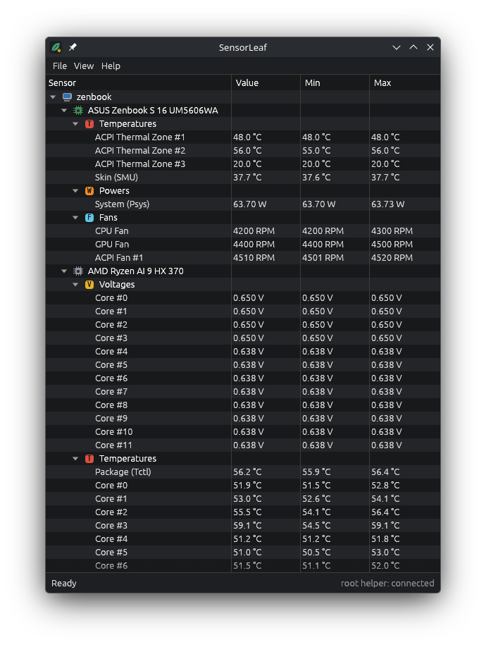

# SensorLeaf

A hardware sensor monitor for Linux. One window, one tree, four columns:
**Sensor | Value | Min | Max**. Written in Rust (egui), dark theme, refreshes every second.



## Features

- Tree: host → device (mainboard, CPU, GPU, NVMe, battery, Wi-Fi, USB-C) → sensor group → sensor.
- Groups in a fixed order: Voltages, Temperatures, Powers, Currents, Clocks, Utilization, Throughput, Fans, Capacities, Levels.
- Units: `1.125 V`, `54.0 °C`, `12.34 W`, `4890 MHz`, `37 %`, `2400 RPM`, `78046 mWh`.
- Min and Max since start; **View → Clear Min/Max**.
- **File → Save monitoring data…** writes a plain-text report of the whole tree.
- Expand/collapse arrows (click the arrow or double-click a row).
- `sensorleaf-cli` prints the same tree as text (`--watch` to refresh) for checking against `sensors`.
- Root-only counters come from a tiny read-only helper; the GUI never runs as root.
- Values are only shown when the hardware reports them. Nothing is estimated.

## Supported sensors and how they are read

| Device | Sensor | Source | Needs root |
|---|---|---|---|
| CPU | Package temperature (Tctl/Tdie, Tccd) | hwmon `k10temp` | no |
| CPU | Per-core temperature, SoC temperature | amdgpu `gpu_metrics` v3.0 (SMU telemetry) | no |
| CPU | Package, APU, all-core, per-core and NPU power | amdgpu `gpu_metrics` v3.0 | no |
| CPU | Per-core clock, core clock limit, FCLK, UCLK, SOCCLK, NPU clocks | amdgpu `gpu_metrics` v3.0 | no |
| CPU | Per-core C0 residency, NPU column activity, DRAM/NPU bandwidth | amdgpu `gpu_metrics` v3.0 | no |
| CPU | Processor and per-thread utilization | `/proc/stat` | no |
| CPU | Per-thread clock (fallback without helper) | cpufreq `scaling_cur_freq` | no |
| CPU | Package power (RAPL) | powercap `intel-rapl:0/energy_uj` | **yes** (helper) |
| CPU | Per-core power (MSR) | MSR `0xC001029A` core energy, unit `0xC0010299` | **yes** (helper) |
| CPU | Per-thread effective clock | MSR `0xE8` APERF delta / time | **yes** (helper) |
| CPU | Per-core voltage | `ryzen_smu` PM table, version 0x5D0009 (Strix Point), 12 × f32 at 0xA0C | **yes** (helper + optional module) |
| GPU | Edge temperature, PPT power, SCLK, VDDGFX/VDDNB (when non-zero) | hwmon `amdgpu` | no |
| GPU | GFX temperature, GFX power, GFX/VCLK/VPECLK, GFX/VCN activity | amdgpu `gpu_metrics` | no |
| GPU | MCLK, busy %, VRAM/GTT used and total | amdgpu sysfs (`pp_dpm_mclk`, `gpu_busy_percent`, `mem_info_*`) | no |
| Mainboard | ACPI thermal zones | hwmon `acpitz` | no |
| Mainboard | Skin temperature, system power (Psys) | amdgpu `gpu_metrics` | no |
| Mainboard | CPU/GPU fan RPM | hwmon `asus` (asus-wmi) | no |
| Mainboard | ACPI fan RPM | hwmon `acpi_fan` | no |
| NVMe | Composite and sensor temperatures | hwmon `nvme` | no |
| Battery | Voltage, charge/discharge rate, capacities, wear level, charge level | `/sys/class/power_supply/BAT*` | no |
| Wi-Fi | Temperature | hwmon (e.g. `mt7925_phy0`) | no |
| USB-C | VBUS voltage and current | hwmon `ucsi_source_psy_*` | no |

Not available on Strix Point and therefore not shown:
- **PPT/STAPM limits**: the firmware reports them as unsupported (`0xFFFF`) in `gpu_metrics`.
- **Per-core voltage without `ryzen_smu`**: it is not in any MSR, hwmon or `gpu_metrics` field.
  The P-state MSR only holds a requested VID, which is not a measured voltage.
- **zenpower**: does not support Zen 5 (family 1Ah).

## Install (Arch / CachyOS)

```bash
git clone https://github.com/yukentsii/sensorleaf.git
cd sensorleaf
makepkg -si
```

Build dependency: `cargo`. The package enables `sensorleaf-helper.socket`; then start **SensorLeaf** from the app menu.

Optional per-core voltage on supported AMD APUs: install `ryzen_smu-dkms-git` (AUR, third-party kernel module)
The helper loads it on start if it is installed and only reads its PM table. Only PM table
version 0x5D0009 is decoded, because it is the layout checked on real hardware; other versions show no voltage.

Files installed:

| Path | Purpose |
|---|---|
| `/usr/bin/sensorleaf` | GUI |
| `/usr/bin/sensorleaf-cli` | text output |
| `/usr/lib/sensorleaf/sensorleaf-helper` | read-only root helper |
| `/usr/lib/systemd/system/sensorleaf-helper.socket`, `.service` | socket-activated helper |
| `/usr/lib/modules-load.d/sensorleaf.conf` | loads the `msr` module at boot |
| `/usr/share/applications/sensorleaf.desktop` | app menu entry |
| `/usr/share/icons/hicolor/scalable/apps/sensorleaf.svg` | icon |
| `/etc/systemd/system/sockets.target.wants/sensorleaf-helper.socket` | enable symlink (created by `systemctl enable`) |

## The root helper

`sensorleaf-helper` runs only when a client connects to `/run/sensorleaf/helper.sock` and exits after
two idle minutes. It opens every device read-only and reads a fixed list: RAPL `energy_uj`,
MSRs `0xC0010299`, `0xC001029A`, `0xC001029B`, `0xE7`, `0xE8`, and the `ryzen_smu` PM table if present.
It contains no code that writes to an MSR, the SMU or any register. Answers are cached for 500 ms
so the energy counters cannot be sampled fast enough for power side-channel attacks (CVE-2020-8694).
The systemd unit sandboxes it (no network, read-only filesystem, only `cpu/msr` devices, `CAP_SYS_RAWIO`).

## Build from source

```bash
cargo build --release
./target/release/sensorleaf-cli
```

## License

MIT, see [LICENSE](LICENSE).
